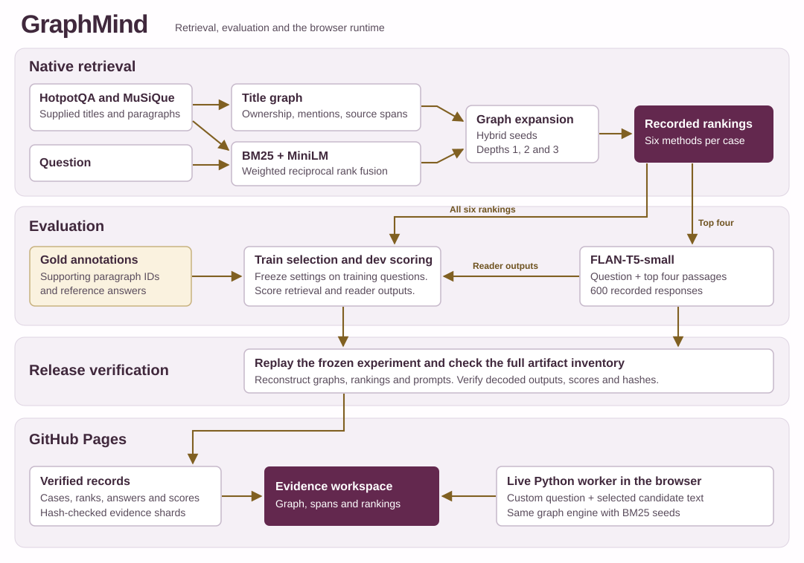

# GraphMind

GraphMind retrieves evidence for questions whose answers depend on more than one paragraph. It builds a graph from the candidate paragraphs’ article titles and the exact places those titles appear in the text. Following a link can retrieve a supporting paragraph that shares few words with the question. In the [evidence explorer](https://sashankpotluru.github.io/GraphMind/), select a connection to read the mention that created it.

The evaluation uses the supplied candidate contexts from HotpotQA distractor and MuSiQue-Ans. Each context already contains the annotated support. Across all **9,822 official development questions**, graph expansion retrieved complete evidence more often in the first four results. The first relevant paragraph moved down on average on both datasets. A separate matched reader experiment left the effect on answer quality uncertain.

## What changed in retrieval?

AllSupport@4 is the share of questions for which the first four paragraphs contain **every** annotated supporting paragraph. Graph-1, Graph-2 and Graph-3 start from the same hybrid scores and share their dataset’s training-selected mix and seed count. The number denotes paragraph graph transitions.

| Method | HotpotQA AllSupport@4 | HotpotQA MRR | MuSiQue AllSupport@4 | MuSiQue MRR |
| --- | ---: | ---: | ---: | ---: |
| BM25 | 63.97% | .9190 | 15.27% | .7787 |
| Dense MiniLM | 59.58% | .8924 | 22.47% | .8440 |
| Hybrid RRF | 68.94% | .9239 | 22.80% | .8553 |
| Graph-1 | 86.32% | .8242 | 32.02% | .7965 |
| Graph-2 | 86.08% | .8244 | 32.11% | .7967 |
| Graph-3 | 86.01% | .8262 | 32.11% | .7964 |

Against hybrid, Graph-2 gained **17.14 percentage points** on 7,405 HotpotQA questions and **9.31 points** on 2,417 MuSiQue questions. The paired query bootstrap 95% intervals were [16.11, 18.18] and [7.78, 10.84] points. Two-sided paired sign-flip tests with Holm correction gave p = 1.73 × 10⁻²²¹ and 3.56 × 10⁻³³. The Hotpot comparison stratum lost 3.03 points, while bridge questions gained 22.20. MuSiQue questions annotated as two-, three- and four-hop gained 14.70, 4.08 and 2.47 points. These descriptive strata refer to the original QA questions. An evidence chain of two paragraphs can be connected by just one graph edge. More graph depth did not consistently help. [Full retrieval results](https://sashankpotluru.github.io/GraphMind/#results) · [Paired estimates and component sizes](results/retrieval/primary.json)

A question-level interval assumes independent questions. Resampling components of questions with shared exact support paragraphs gave [16.08, 18.19] and [6.65, 12.11] points. Hotpot had 6,472 components with a largest component of nine questions. MuSiQue had 528, with a largest component of 84. Topics and subquestions can repeat across components. The raw records retain all wins, losses and ties.

## What happened to the answers?

After retrieval settings were frozen, the same FLAN-T5-small reader answered 100 hash-selected questions per dataset under each of three retrievers. Every prompt used the question and its top four retrieved passages, with up to 96 context tokens per passage and at most 512 total input tokens. Greedy decoding allowed 48 new tokens. The release includes all 600 predictions, their exact prompts, source spans, input and decoder IDs, and scores checked against the datasets’ official answer scorers. Two MuSiQue outputs decoded to empty strings.

| Retrieval used by reader | HotpotQA EM | HotpotQA token F1 | MuSiQue EM | MuSiQue token F1 |
| --- | ---: | ---: | ---: | ---: |
| Dense | 20% | 26.51% | 7% | 14.50% |
| Hybrid | 17% | 26.40% | 7% | 13.41% |
| Graph-2 | 20% | 29.67% | 9% | 13.93% |

Graph-2 minus hybrid F1 was +3.27 points on HotpotQA (95% query interval −2.77 to +9.54, Holm p = .607) and +0.52 on MuSiQue (−3.98 to +5.25, Holm p = .839). Both intervals include zero. Token overlap measures agreement with reference strings. Semantic faithfulness, the effect of longer contexts and model pretraining exposure remain open questions. The experiment covers supplied Wikipedia paragraphs from official dev sets. Open-corpus search and hidden-test generalization are outside its scope. [Reader protocol](docs/answer-protocol.md) · [Answer results](results/answers/summary.json)

## How the engine works



[Mermaid diagram source](docs/architecture.mmd) · [Engine schema and scoring equations](docs/engine-contract.md)

1. Build the graph from paragraph IDs, titles and original text. Each paragraph owns a canonical title entity. A mention links an exact source span to a full title or a unique eligible alias. Matching handles Unicode normalization, case folding and whitespace. Offsets count Unicode code points in the original text.
2. Project mention–owner pairs and shared-title ownership to undirected paragraph neighbors. Repeated mentions retain their individual source spans and contribute one neighbor for the walk. A link records lexical connectivity. Establishing factual relationships and explaining the reader’s internal reasoning would require separate evidence.
3. Score every supplied candidate using BM25 and pinned MiniLM cosine similarity. Weighted reciprocal rank fusion combines their complete rankings. For each dataset, select fusion weights, graph mix and seed count on 500 hash-selected training questions. Both datasets selected an RRF constant of 10 and two graph seeds. The dense weights were .50 and .75, and graph mixes .60 and .35 for HotpotQA and MuSiQue respectively.
4. Walk from the highest positive seeds on the projection. A dangling paragraph keeps its mass. Combine the distributions at steps 0 through the chosen depth with weights proportional to 0.5ᵗ, then mix with the normalized base scores. Every result includes the component scores, hop distributions and each seed’s contribution.

Gold support and reference answers enter training selection and evaluation. Graph construction, embeddings, retrieval inputs and reader prompts use corpus or query fields only. Per-query AllSupport and recall at 2/4/6, binary nDCG@4 and MRR were independently checked across 471,456 development metric values. The largest discrepancy was zero. Independent official reader scoring differed by at most 1.11 × 10⁻¹⁶. Repeated train/dev article identities and input truncation are recorded in each dataset’s audit. [Retrieval protocol](docs/retrieval-protocol.md) · [HotpotQA source audit](results/retrieval/hotpot/source-audit.json) · [MuSiQue source audit](results/retrieval/musique/source-audit.json)

On the measured Apple M4 Pro CPU, a warm Graph-2 query took 4.16/4.95 ms at p50/p95 on HotpotQA and 4.51/5.55 ms on MuSiQue. Timing used one warmup and five sequential measurements on 64 hash-selected questions per dataset. Index and graph setup were measured separately. [HotpotQA timings](results/retrieval/hotpot/dev/timing-summary.json) · [MuSiQue timings](results/retrieval/musique/dev/timing-summary.json)

## Run GraphMind

Python 3.12 or 3.13 is sufficient for the dependency-free core. From the repository root:

```sh
python -m venv .venv
. .venv/bin/activate
python -m pip install -e .
graphmind query tests/fixtures/bridge.json --depth 2 --mix 1 --seeds 1
graphmind query tests/fixtures/bridge.json --question "Who hired weavers?"
graphmind export tests/fixtures/bridge.json --output neo4j.json
```

The CLI accepts a JSON case or an array of objects with `id`, `title` and `text`. The export creates parameterized Neo4j statements. The evaluated runtime is the in-process Python graph. [CLI and Python contract](docs/engine-contract.md)

The browser shows 200 hash-selected recorded contexts and lets you run a custom question against any of them. Custom retrieval runs the packaged original Python source in a pinned Pyodide 0.29.3 worker with BM25 seeds, mix .35 and two seeds. Model-based rankings and FLAN answers are recorded measurements. The Architecture view has a parity check for an authored bridge and a real HotpotQA context. [Live workspace](https://sashankpotluru.github.io/GraphMind/) · [Architecture and parity check](https://sashankpotluru.github.io/GraphMind/#architecture)

## Reproduce the experiment

Clone with full Git history so verification can resolve the measurement commits. To replay the published records without model weights or the raw source downloads:

```sh
python -m pip install -e . -r requirements-replay.txt -r requirements-dev.txt
python -m benchmarks.verify
python -m pytest -q
ruff check .
ruff format --check benchmarks scripts src tests
mypy
node --test web/tests/*.test.mjs
```

Replay rebuilds every candidate graph and ranking, checks scores against stored vectors, repeats train-only parameter selection and statistical comparisons, reconstructs prompts, decodes stored output IDs, and checks both official answer scorers. An outer manifest covers 1,222 hashed artifacts. Original timing and model execution are historical observations. Hashes allow consistency checks, and reproducing the model runs requires the separate command below. The original FLAN embedding weight audit was retrospective. New runs verify those weights before generation. [Release manifest](results/release.json) · [FLAN weight audit](results/answers/weight-audit.json)

To download the pinned data and model sources and rerun both CPU experiments, use a fresh destination:

```sh
python -m pip install -e . -r requirements-benchmark.txt
scripts/reproduce.sh reproductions/run-01 data/cache
python -m benchmarks.verify --root reproductions/run-01 --reproduction
```

The runner checks source files and refuses to overwrite an existing output. It records timing samples and model outputs under the new run. Runtime and platform can affect floating-point values, generation and timing. HotpotQA uses revision `1908d6afbbead072334abe2965f91bd2709910ab`; MuSiQue uses the v1.0 author archive. The pinned model revisions are `1110a243fdf4706b3f48f1d95db1a4f5529b4d41` for MiniLM and `0fc9ddf78a1e988dac52e2dac162b0ede4fd74ab` for FLAN-T5-small. [Data sources and hashes](benchmarks/sources.json) · [Encoder manifest](benchmarks/model.json) · [Reader protocol](docs/answer-protocol.md)

## Build the demo

```sh
python -m pip install -e . -r requirements-replay.txt
python scripts/build_site.py
python -m http.server 8000 --bind 127.0.0.1 --directory site
```

Open `http://127.0.0.1:8000/`. The build verifies the release before staging an explicit file allowlist, then writes a SHA-256 inventory to `site/site-manifest.json`. Runtime files come from the hash-pinned Pyodide archive on the first build. All subsequent browser requests stay on the static site, including the first custom retrieval. The full evidence inventory is available for download and the UI loads bounded shards on demand. In GitHub Settings → Pages, select GitHub Actions. A push to main runs Python 3.12/3.13 checks and Node worker tests before building and deploying Pages. Original code is MIT. HotpotQA material retains CC BY-SA 4.0 and MuSiQue retains CC BY 4.0. Upstream article titles identify Wikipedia contributors. [Third-party sources and licenses](THIRD_PARTY_NOTICES.md)
